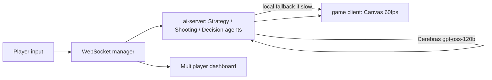

# Terminator

A browser-based dodge/shooter game where an AI "Overlord" watches your movement patterns in real time and spawns obstacles to intercept where you're predicted to go next, using Cerebras for fast inference so the AI can react within a game-relevant time budget.

**Status:** Hackathon project (weekend hackathon, September 2025). Not maintained.

## What it does

- 5-lane dodge game: move, shoot, survive against an AI-controlled obstacle spawner.
- Multiple small AI agents split by responsibility (movement-pattern analysis, targeting, final decision) rather than one big prompt.
- A hybrid path: an immediate local/rule-based fallback fires first so the game never stalls, with the AI enhancement layered in asynchronously when it returns in time.
- WebSocket multiplayer: a dashboard shows several players at once, each joining by scanning a QR code on their phone.
- Live "thinking" display so the AI's reasoning is visible to players during play, not just its resulting action.

## Architecture



- `packages/ai-server/` - Node/Express server, Cerebras integration, WebSocket manager, the three-agent decision pipeline
- `packages/game/` - vanilla JS + HTML5 Canvas game client (Vite)

## Technical notes

- Target AI decision latency is under 400ms, with a local fallback so a slow or failed API call never blocks gameplay.
- The three agents (strategy, shooting, decision) are a simple form of multi-agent orchestration: each has a narrow job, and the decision agent reconciles their outputs into one action.

## Usage

```bash
npm install
```

Create `packages/ai-server/.env`:

```env
CEREBRAS_API_KEY=your_cerebras_api_key_here
CEREBRAS_MODEL=gpt-oss-120b
PORT=8787
```

```bash
npm run dev
```

Starts the AI server (`:8787`) and game client (`:3000`). Open `http://localhost:3000/terminator.html`, arrow keys to move, spacebar to shoot. For multiplayer, the main interface shows QR codes for phones to join a room.

## Personal contribution

Built with one teammate over a weekend hackathon; I wrote the large majority of the commits (physics/game loop, the AI-server agent pipeline, and the Cerebras integration).

## License

No formal license file. The original author note said "use it freely, no license required" - treat that as informal permission, not a substitute for an actual license; ask before reusing in anything that needs one.

## Contact
- Prajit Viswanadha: https://www.linkedin.com/in/prajit-viswanadha/
- Shashank Yaji: https://www.linkedin.com/in/shashankyaji/
